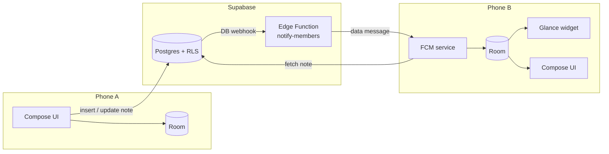

# jOURnal

**Shared notes that live on your home screen.** jOURnal is an Android app for small groups (2–10 people: a couple, a family, close friends). Anyone in the group writes a note, and every member can pin any note to a home-screen widget that updates itself within seconds when the note changes, without opening the app.

> Status: early development. Milestone **M0 (foundation)** is done; see [roadmap](#roadmap).

## Features (planned for v1)

- No sign-up friction: enter a name and email, and you're in (Supabase anonymous auth under the hood)
- Create a group and share a 6-character invite code, or join one
- Write, edit and soft-delete notes in pastel "sticky note" colors
- Home-screen widgets (2×2 to 4×4), each showing one note you pick
- Near-real-time updates: Supabase Realtime while the app is open, FCM push + WorkManager fallback when it's closed
- Works offline; syncs when back online

## Architecture



Key rules:

- **One-way data flow:** Supabase → Repository → Room → UI / widget. The widget never touches the network.
- **Security lives in the database:** every table is protected by Row Level Security, and group membership changes only go through `security definer` RPCs. These rules are covered by [pgTAP tests](supabase/tests/database).
- **Free to run:** Supabase free tier + Firebase Cloud Messaging only.

## Tech stack

| Layer | Tech |
|---|---|
| Android | Kotlin 2.4, Jetpack Compose (Material 3), Glance, Room, Hilt, WorkManager |
| Backend | Supabase: Postgres, RLS, Auth (anonymous), Realtime, Edge Functions, pg_cron |
| Push | Firebase Cloud Messaging (HTTP v1) |
| Quality | ktlint, detekt, JUnit, Turbine, MockK, pgTAP |

## Project structure

```
.
├── android/          Android app (Gradle, single :app module)
├── supabase/
│   ├── migrations/   Schema, RLS policies, RPCs, scheduled jobs
│   └── tests/        pgTAP tests for RLS and RPCs
└── docs/
    ├── PRD.md        Product requirements (Indonesian)
    └── DESIGN.md     Design tokens and screens (Indonesian)
```

## Getting started

Requirements: JDK 21, Android SDK 37, [Supabase CLI](https://supabase.com/docs/guides/cli), Docker (for local database tests).

1. **Supabase**: create a project and enable *Authentication → Allow anonymous sign-ins*.
2. **Secrets**: copy `.env.example` to `.env` and fill in your project's values.
3. **Firebase**: create a project, add an Android app with package `com.iqbal.journal`, and put its `google-services.json` in `android/app/`.
4. **Database**:
   ```sh
   supabase link --project-ref <your-project-ref>
   supabase db push
   ```
5. **Build**:
   ```sh
   cd android
   ./gradlew assembleDebug        # APK in app/build/outputs/apk/debug/
   ./gradlew ktlintCheck detekt   # code style
   ```
6. **Database tests** (local):
   ```sh
   supabase db start && supabase test db
   ```

## Roadmap

- [x] **M0** Foundation: project setup, schema, RLS, tests
- [ ] **M1** Profile & groups (create / join with invite code)
- [ ] **M2** Notes (CRUD, Room cache, Realtime)
- [ ] **M3** Widget (pick a note, reconfigure)
- [ ] **M4** Push & background sync (Edge Function, FCM, WorkManager)
- [ ] **M5** Polish & signed release APK

## License

[MIT](LICENSE). Bundled fonts (Bricolage Grotesque, Figtree) are under the SIL Open Font License.
